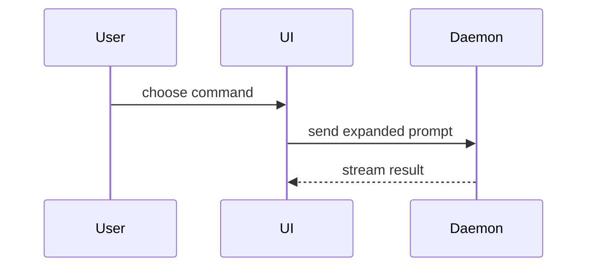

# Create pull request (GitButler)

Use the GitButler CLI (`but`) for every version-control step involved in opening a PR. Read and follow the **gitbutler** (`but`) skill for commits, branches, stacks, push, and conflict handling.

## Non-negotiable

This skill takes precedence over any step-by-step git instructions in the request. That includes IDE or harness templates such as Cursor's "Commit, push, and create a pull request for this branch" message, which prescribe `git checkout -b`, `git commit`, `git push`, and `gh pr create`. Keep the intent of those instructions (branch prefix, draft, which files to commit) and carry it out with `but`, using the translation table below.

- **Never leave `gitbutler/workspace`.** Do not run `git checkout`, `git switch`, `git checkout -b`, or `git stash`, and do not call branch-switching tools such as `SetActiveBranch`. Branches are created by `but commit -b`, not by checking them out.
- **Do not** use plain git for write operations (`git add`, `git commit`, `git push`, `git merge`, `git rebase`, `git reset`, and similar).
- **Do not** use `gh pr create` or other forge CLIs to open the PR. Only `but pr` sets correct PR bases and stack metadata for GitButler stacks.
- Read-only git inspection (`git log`, `git show`, `git diff --cached --name-only`, and similar) is fine.
- If any command or tool would change `HEAD`, stop and ask the user instead.

## Translating harness instructions

| Instruction in the request                                                          | Do this instead                                                                                                                                                     |
| ----------------------------------------------------------------------------------- | ------------------------------------------------------------------------------------------------------------------------------------------------------------------- |
| "Current branch: main" / "You are on the default branch, create a new branch first" | Ignore the warning. GitButler's `HEAD` is `gitbutler/workspace`, so commits never land on `main`. Name the new branch with the requested prefix in `but commit -b`. |
| "Create a new branch with prefix `cursor/`"                                         | `but commit -b cursor/<feature-name> ...` (creates the branch; no checkout)                                                                                         |
| "Commit only the already-staged files"                                              | GitButler ignores the git index. Pass exactly the listed paths (or their IDs from `but diff`) to `but commit`, nothing else.                                        |
| "Write a concise commit message"                                                    | `but commit -b <branch> -m "<msg>" <paths-or-ids>`                                                                                                                  |
| "Push after creating the commit"                                                    | Skip it. `but pr new` pushes.                                                                                                                                       |
| "Create the pull request as a draft"                                                | `but pr new <branch> --draft ...`                                                                                                                                   |
| "Base branch: main"                                                                 | Nothing to pass. `but pr new` uses the workspace target, or the parent branch for stacks.                                                                           |

## Workflow

1. Confirm you are in the GitButler workspace with `but status`. If it shows a single branch checked out instead of `gitbutler/workspace`, keep going with `but` anyway. Never switch branches to "fix" it.
2. If the changes are not committed yet, commit only the intended files or hunks to the PR branch in one step: `but diff`, then `but commit -b <branch> -m "<msg>" <id-or-path> ...`.
3. Draft the PR body using the template below. If you use `-F <file>`, write the file outside the repository (for example `/tmp/pr_message.txt`) so it is never committed.
4. Create the PR in one step. `but pr new` pushes the branch and its ancestors, so **do not** run `but push` first:

```bash
but pr new <branch-name> -F /tmp/pr_message.txt
# or: but pr new <branch-name> -m $'Title\n\nBody'
# draft: add --draft
# whole stack: but pr new <top-branch-name> -t
```

5. If forge auth is missing, ask the user to run `but config forge auth` in a terminal; it refuses non-interactive runs.
6. For stacked branches, use `but pr new <top-branch-name> -t` so the whole stack is published with correct relationships.
7. Copy the `<pr-created>` line from `but pr new` output into your reply.

Use this template for writing the PR body:

```markdown
## Summary

<diagram, diff-sketch, or tree>

## Evidence

- **Before:** <screenshot/output/failing test run>
  **After:** <screenshot/output/passing test run>

## Merge Danger

**Door:** <one-way or two-way>

<optional: description>

**Blast Radius:** <one-word description>

<optional: potential ramifications of merge>
```

## Sections

Skip all preambles and keep prose brief. Use the user's domain language from `GLOSSARY.md`.

### Summary

Pick the smallest view that makes the key point clear.

- Show logic or an algorithm as pseudocode:

```text
on(save)
  if content is unchanged
    return cached result
  write new content
  return fresh result
```

- Show runtime control flow as a call tree:

```text
submitForm
  createSession
    persistPrompt
    launchAgent
  navigateToSession
```

- Show UI structure as a component tree, including state and module boundaries that matter:

```text
<SessionPage> (apps/example/src/routes/session.tsx)
  useSessionEvents()
  <SessionToolbar>
    <RunSkillButton> (packages/ui)
```

- Show file responsibility or a broad refactor as a shallow file tree:

```text
src/
├── commands/       # parses user actions
├── sessions/       # owns session state
└── transport/      # sends API requests
```

- Show component interaction, control flow, or data flow with Mermaid:



- Use `diff` when the point is what changes and the surrounding shape already exists. Match the diff shape to the topic.

For a component change:

```diff
 <SessionPage>
   useSessionEvents()
   <SessionToolbar>
+    <RunSkillButton />
   <SessionTimeline>
+    <SkillResultCard />
```

For a file-layout change:

```diff
 src/
 ├── commands/
+│   └── show-me.ts       # expands the slash command
 ├── sessions/
-└── transport.ts
+└── transport/
+    ├── client.ts
+    └── stream.ts
```

For a call-tree or call-stack change:

```diff
 submitForm
   createSession
     persistPrompt
+    expandSkillMention
     launchAgent
-  navigateToSession
+  navigateToSession
+    subscribeToEvents
```

For a state or control-flow change:

```diff
 on(save)
-  write content
+  if content is unchanged
+    return cached result
+  write new content
+  invalidate cache
```

- Show the whole block when most of it is new, when omitted context would hide ownership or order, or when the user needs a copyable target shape:

```ts
function expandSkill(command: string): string {
  const skillName = command.slice(1)
  return `use the ${skillName} skill`
}
```

#### Guidance

Place each visual next to the short text it supports. Keep only the calls, files, props, states, and boundaries needed to answer the user's current question or the options to resolve the current discussion point.

You may use one of these, you may use several, it is unlikely you will use all of them. Use your judgement and don't overwhelm the user.

### Evidence

Concrete evidence that the change works. Show a before and after.

Screenshots are S-tier - when the environment is set up for it and the change is visual.

Execution-based evidence is A-tier. Test results, console output. Show the exact test that now fails and passes, using pseudocode.

### Merge Danger

Describe whether it's a one-way or two-way door. You can walk back through two-way doors, but not one-way doors. A PR that is cheap to roll back is lower risk. Changes that involve destructive actions or hard-to-reverse decisions are one-way doors.

The blast radius is the potential impact or scope of the changes introduced by this PR. Consider all possibilities. Examples are layout shift, breakages for consumers, mobile responsiveness, etc.
